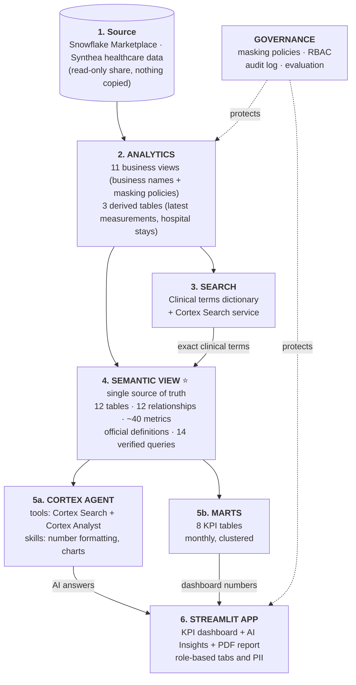
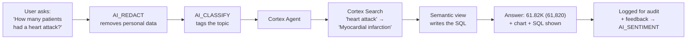

# 🩺 Healthcare Semantic Layer + Cortex Agent on Snowflake

An end-to-end **healthcare AI analytics platform** built on Snowflake.
One **semantic view** is the single source of truth. A **Cortex Agent** answers questions in plain English, **KPI marts** feed the dashboard, and a **Streamlit app** brings it together with role-based security, so every number on the dashboard matches the AI's answer.

> Data: synthetic patient records ([Synthea](https://synthetichealth.github.io/synthea/)) from the Snowflake Marketplace: 1.42mn patients, 64.54mn visits, 763mn clinical measurements. No real patient data.

---

## 🏗️ Architecture



### How a question flows through the platform



---

## ✨ What it does

| Area | Features |
|---|---|
| **Semantic layer** | Business names (no raw columns), synonyms, official definitions (heart attack, BP medication, readmission, open claim), Cortex Search links, verified queries, custom AI instructions |
| **Cortex Agent** | Orchestration and response instructions, budget (120 s / 20K tokens), 5 sample questions, 3 skills (`number_formatting`, `chart_types`, `chart_styling`) |
| **Security** | Role-based **masking policies**, RBAC on tabs and charts, role-based PII on the Patients tab, `AI_REDACT` on every question |
| **Performance** | Pre-aggregated **KPI marts** built from the semantic view, **clustering** on month columns, 10-minute query **caching** in the app |
| **AI functions** | `AI_REDACT`, `AI_CLASSIFY`, `AI_SENTIMENT`, `AI_COMPLETE`, `DATA_AGENT_RUN` |
| **Evaluation** | UI Agent Evaluations (AI judge) + a rule-based SQL harness: **13 / 13 passed** |
| **Governance** | Audit log of every question, answer, response time and token count (daily task) |
| **Reporting** | Paginated **PDF report**: page numbers, repeating headers, only the sections the role may see |

---

## 🔐 Role-based access

### Who sees which tab

| Tab | Executive | Clinical | Finance | Analyst | Engineer |
|---|:-:|:-:|:-:|:-:|:-:|
| 📊 Overview | ✅ | ✅ | ✅ | ✅ | ✅ |
| 🩺 Clinical · 🏥 Hospital | | ✅ | | ✅ | ✅ |
| 💊 Pharmacy & Vaccines | | ✅ | ✅ | ✅ | ✅ |
| 💰 Claims & Cost | ✅ | | ✅ | | ✅ |
| 👤 Patients | | ✅ | | ✅ | ✅ |
| 🤖 AI Insights | ✅ | ✅ | ✅ | ✅ | ✅ |
| 🔐 Governance · ✅ Quality | | | | | ✅ |

### Who sees which personal data (masking policies)

| Column | DATA_ENGINEER | HC_CLINICAL_ANALYST | All other roles |
|---|---|---|---|
| First / last name | real | real | `***MASKED***` |
| SSN | real | `XXX-XX-1234` | `XXX-XX-XXXX` |
| Street address | real | `***MASKED***` | `***MASKED***` |
| Birth / death date | real | real | year only |

---

## 📁 Files

| File | What it builds |
|---|---|
| `config.py` | Every object name in one place: no hardcoding |
| `run.py` | Runs the SQL files in order, replacing `{{NAMES}}` from `config.py` |
| `01_setup.sql` | Warehouse, database, 4 schemas, 5 roles |
| `02_business_views.sql` | 11 business views, **role-based masking policies**, PII function for the app |
| `03_derived_tables.sql` | Latest measurement per patient, patient profile, hospital stays with 30-day readmission (clustered) |
| `04_search.sql` | Clinical terms dictionary + **Cortex Search** service |
| `05_semantic_view.sql` | **Semantic view**: 12 tables, 12 relationships, facts, dimensions, ~40 metrics, 14 verified queries |
| `06_agent.sql` | Cortex Agent in SQL (this project's agent was built in the **UI** instead) |
| `07_marts.sql` | 8 KPI marts built **from** the semantic view, monthly and clustered |
| `08_evaluation.sql` | 13 gold questions, `RUN_AGENT_EVAL` procedure, PASS/FAIL scorecard |
| `09_audit_log.sql` | Daily task copying agent events + conversation history view |
| `10_security.sql` | Grants, app tab permissions, PII levels, app logs |
| `11_snowflake_intelligence.sql` | Optional: add the agent to Snowflake CoWork |
| `agent_eval_dataset.sql` | Dataset for the UI Agent Evaluations |
| `streamlit_app.py` | The app |
| `skills/` | 3 agent skills (`SKILL.md` each) |

---

## 🚀 How to run

1. **Get the data:** Snowflake Marketplace → *Synthetic Healthcare Data (Clinical and Claims)* → **Get**.
2. **Upload the files** to a Snowsight Workspace folder and create a notebook in the same folder.
3. **Build** (as ACCOUNTADMIN):
   ```python
   import run
   run.run()
   ```
4. **Skills:** upload `skills/` to the stage `ANALYTICS.AGENT_SKILLS`, then add them to the agent (Agent → Edit → Skills).
5. **App:** `run.create_app()`, or create a Streamlit app in Snowsight and paste `streamlit_app.py` + `config.py` (add the `reportlab` package for PDF reports).
6. **Evaluate:** `run.run_evaluation()`

> Masking policies need **Enterprise edition** or higher.

---

## 📊 Number formatting rules

| Type | Format | Example |
|---|---|---|
| Counts | K / mn / bn, 2 decimals | `61.82K`, `1.42mn` |
| Money | $ + K / mn / bn | `$174.25bn` |
| Percentages | exactly 2 decimals | `17.06%` |
| First sentence of an AI answer | short form + exact count | `61.82K (61,820) patients` |

---

## 🧰 Tech stack

Snowflake · Semantic Views · Cortex Analyst · Cortex Search · Cortex Agents · Agent Skills · Cortex AI functions · Masking Policies · Streamlit in Snowflake · Python (Snowpark, pandas, Altair, ReportLab) · SQL

---

*Synthetic data only, not medical advice.*

